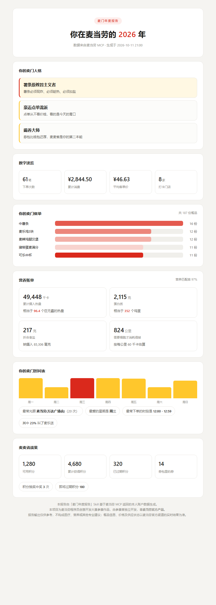

# 麦门年度报告 · Maimen Wrapped

> 你在麦当劳花过的钱、吃过的堡、熬过的夜，值得一张能晒的报告。

基于**麦当劳 MCP** 的个人年度账单 Skill：读取你的历史订单、积分、券包和官方营养库，
生成一张自包含的 HTML 年度报告——有人格标签、有热量换算、有可截图的视觉版式。



## 它能告诉你什么

- **你的麦门人格**：薯条原教旨主义者 / 深夜麦门人 / 薅券大师 / 早餐战神……按你的真实订单算出来
- **数字速览**：下单次数、累计消费、平均客单价、打卡门店数
- **你的麦门餐单**：点得最多的 5 样东西，条形榜
- **营养账单**：累计多少千卡——相当于几个巨无霸？多少克盐？得慢跑几公里才消耗得掉？
- **你的麦门时间表**：最爱星期几、最常下单的时段、麦乐送占比
- **麦麦省战果**：积分余额、过期了多少、券包里还躺着几张

所有换算基于麦当劳 MCP 官方营养库（160 款餐品），不是拍脑袋估的。

## 目标用户

- 常点麦当劳、想知道自己"这一年到底吃了多少"的人
- 想要一张能发朋友圈 / 群里的年度账单图的人
- 想找麦当劳 MCP 接入样板的开发者（本项目只读、零支付、纯标准库，适合当第一个练手项目）

## 快速开始

### 方式一：在 WorkBuddy 里用（推荐）

1. 到 [open.mcd.cn/mcp](https://open.mcd.cn/mcp) 注册并申请 MCP Token；
2. WorkBuddy → 左侧边栏【专家·技能·连接器】→【连接器】→ 右上角【自定义连接器】→【配置 MCP】，
   粘贴 `mcp-config.example.json` 的内容并把 `YOUR_MCP_TOKEN` 换成你的 Token，保存并启用；
3. 安装本 Skill（把本仓库放进 `~/.workbuddy/skills/maimen-wrapped/`）；
4. 对话框输入：**"帮我生成我的麦当劳年度报告"**。

### 方式二：命令行（零依赖）

```bash
git clone https://github.com/Liu-1233/maimen-wrapped.git
cd maimen-wrapped

export MCD_MCP_TOKEN="你的Token"        # Windows CMD: set MCD_MCP_TOKEN=...
python scripts/collect.py               # 采集数据 → data/raw/
python scripts/build_report.py          # 生成报告 → data/麦门年度报告.html
```

没有 Token 想先看看长什么样？

```bash
python scripts/build_report.py --demo   # 用虚构示例数据出一份演示报告
```

环境要求：Python 3.10+，**无任何第三方依赖**（纯标准库）。

## 仓库结构

```
maimen-wrapped/
├── SKILL.md                  # WorkBuddy Skill 定义
├── README.md
├── CONTEST_DECLARATION.md    # 参赛声明（官方原文，未改动）
├── MCP_INTEGRATION.md        # 麦当劳 MCP 集成说明（用了哪些 Tool、调用流程、业务价值）
├── mcp-config.example.json   # 脱敏 MCP 配置示例（仅环境变量占位符）
├── workbuddy.md              # WorkBuddy 开发对话上下文
├── scripts/
│   ├── mcd_client.py         # 麦当劳 MCP 零依赖客户端（标准库）
│   ├── nutrition.py          # 营养库自定义格式解析器
│   ├── collect.py            # 数据采集 → data/raw/
│   ├── build_report.py       # 分析 + HTML 渲染
│   └── make_demo.py          # 生成虚构演示数据
├── sample/demo_data.json     # 演示数据（虚构，结构同真实 MCP 返回）
├── docs/preview.png          # 报告截图
└── data/                     # 运行时生成，已 gitignore
```

## 数据与隐私

- 只读取你**本人**的麦当劳账户数据，全部留在本地 `data/` 目录，不上传、不落库；
- 仓库不含任何真实 Token，配置文件只有环境变量占位符；
- 报告输出仅供参考，不构成医疗、营养或其他专业建议；餐品信息、价格及供应状态以麦当劳官方渠道的实时结果为准。

## 许可与声明

本项目为**麦当劳程序员创意开发大赛**参赛作品，由参赛者独立开发，**非麦当劳官方产品**。
麦当劳、巨无霸等商标归麦当劳所有，本项目不构成任何官方背书。

代码部分以 MIT 许可开源；麦当劳 MCP 的使用须遵守[麦当劳 MCP 服务规则](https://cdn.mcd.cn/cms/pages/MCPServerRules.html)。
